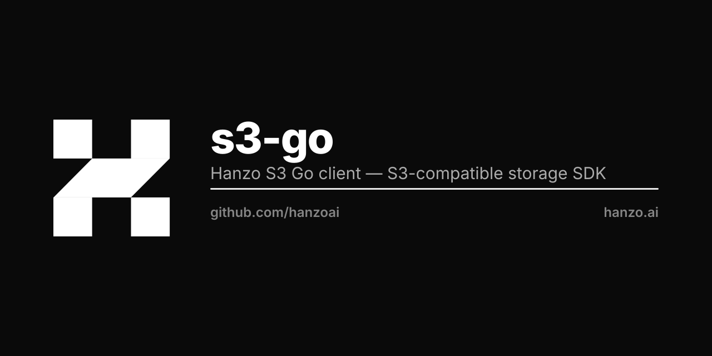

<p align="center"></p>

# Hanzo S3 Go SDK

[](https://pkg.go.dev/github.com/hanzos3/go)
[](LICENSE)

Go client for [Hanzo S3](https://github.com/hanzoai/s3), our S3-compatible
object storage. Built on the MinIO Go client, so the declared Go package is
`minio` — alias the import and the rest reads as you would expect.

One name for one thing: the product is **Hanzo S3**, the repository is
`hanzoai/s3-go`, and the module is `github.com/hanzos3/go`. "Hanzo Storage"
is the retired name — `hanzoai/storage` and `hanzoai/storage-go` are old
paths, not separate products.

## Install

```sh
go get github.com/hanzos3/go
```

## Quick Start

```go
package main

import (
	"context"
	"log"

	s3 "github.com/hanzos3/go"
	"github.com/hanzos3/go/pkg/credentials"
)

func main() {
	client, err := s3.New("s3.hanzo.ai", &s3.Options{
		Creds:  credentials.NewStaticV4("YOUR-ACCESS-KEY", "YOUR-SECRET-KEY", ""),
		Secure: true,
	})
	if err != nil {
		log.Fatalln(err)
	}

	log.Printf("connected: %#v\n", client)
}
```

## Common Operations

### Create a Bucket

```go
ctx := context.Background()
err := client.MakeBucket(ctx, "my-bucket", s3.MakeBucketOptions{
	Region: "us-east-1",
})
if err != nil {
	log.Fatalln(err)
}
```

### Upload an Object

```go
file, err := os.Open("/tmp/data.bin")
if err != nil {
	log.Fatalln(err)
}
defer file.Close()

info, err := client.PutObject(ctx, "my-bucket", "data.bin", file, -1,
	s3.PutObjectOptions{ContentType: "application/octet-stream"})
if err != nil {
	log.Fatalln(err)
}
log.Printf("uploaded: %s (%d bytes)\n", info.Key, info.Size)
```

### Download an Object

```go
obj, err := client.GetObject(ctx, "my-bucket", "data.bin", s3.GetObjectOptions{})
if err != nil {
	log.Fatalln(err)
}
defer obj.Close()

localFile, err := os.Create("/tmp/data.bin")
if err != nil {
	log.Fatalln(err)
}
defer localFile.Close()

if _, err := io.Copy(localFile, obj); err != nil {
	log.Fatalln(err)
}
```

### List Objects

```go
for obj := range client.ListObjects(ctx, "my-bucket", s3.ListObjectsOptions{Recursive: true}) {
	if obj.Err != nil {
		log.Fatalln(obj.Err)
	}
	log.Println(obj.Key, obj.Size)
}
```

### Remove an Object

```go
err := client.RemoveObject(ctx, "my-bucket", "data.bin", s3.RemoveObjectOptions{})
if err != nil {
	log.Fatalln(err)
}
```

### Upload a File from Disk

```go
info, err := client.FPutObject(ctx, "my-bucket", "backup.tar.gz", "/tmp/backup.tar.gz",
	s3.PutObjectOptions{ContentType: "application/gzip"})
if err != nil {
	log.Fatalln(err)
}
log.Printf("uploaded %s (%d bytes)\n", info.Key, info.Size)
```

## API Reference

Full API documentation is available on pkg.go.dev:

- [github.com/hanzos3/go](https://pkg.go.dev/github.com/hanzos3/go)

### Bucket Operations

| Method | Description |
|--------|-------------|
| `MakeBucket` | Create a new bucket |
| `ListBuckets` | List all buckets |
| `BucketExists` | Check if a bucket exists |
| `RemoveBucket` | Remove a bucket |
| `ListObjects` | List objects in a bucket |
| `ListIncompleteUploads` | List in-progress multipart uploads |

### Object Operations

| Method | Description |
|--------|-------------|
| `GetObject` | Download an object |
| `PutObject` | Upload an object from a reader |
| `FGetObject` | Download an object to a file |
| `FPutObject` | Upload an object from a file |
| `StatObject` | Get object metadata |
| `CopyObject` | Copy an object server-side |
| `RemoveObject` | Remove a single object |
| `RemoveObjects` | Remove multiple objects |
| `SelectObjectContent` | Run S3 Select queries on an object |

### Presigned Operations

| Method | Description |
|--------|-------------|
| `PresignedGetObject` | Generate a presigned URL for download |
| `PresignedPutObject` | Generate a presigned URL for upload |
| `PresignedHeadObject` | Generate a presigned URL for HEAD |
| `PresignedPostPolicy` | Generate presigned POST form data |

### Bucket Policy and Notification

| Method | Description |
|--------|-------------|
| `SetBucketPolicy` | Set bucket access policy |
| `GetBucketPolicy` | Get bucket access policy |
| `SetBucketNotification` | Configure event notifications |
| `GetBucketNotification` | Get event notification config |
| `RemoveAllBucketNotification` | Remove all notification configs |
| `ListenBucketNotification` | Listen for bucket events |

## Examples

Working examples live in [`examples/`](examples):

- [`examples/s3/`](examples/s3) -- S3-compatible operations
- [`examples/minio/`](examples/minio) -- extension operations

## Attribution


## License

Copyright (c) Hanzo AI, Inc. Licensed under the [Apache License, Version 2.0](https://www.apache.org/licenses/LICENSE-2.0). See [LICENSE](./LICENSE) for details.
